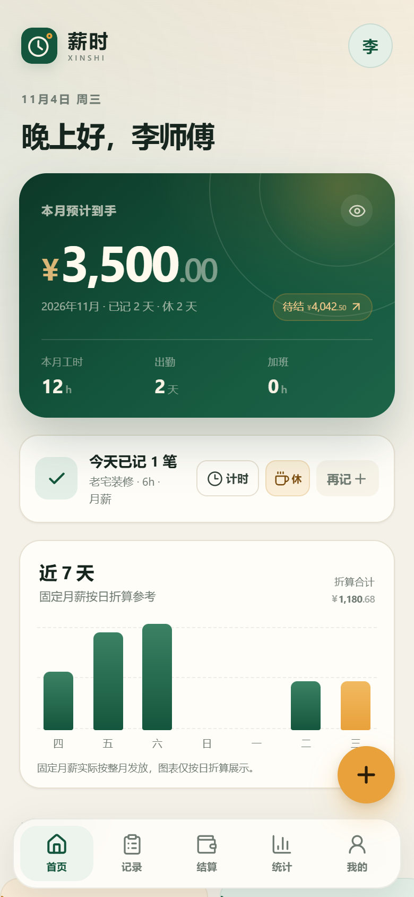

# 薪时 XINSHI · v0.4.3

> **每一小时，都算数。**
>
> 给小时工、日结工、周结工和月结工用的「工时 + 薪资」记录 App。
> 记工时 → 自动算钱 → 逐期结算 → 留底对账，不登录也能用。



v0.3 把账算全；**v0.4 把长期工的真实休息算对**：固定月薪、随机休息、月休额度、6 小时 + 午休 2 小时班次模板。

## v0.4 新增

| 能力 | 说明 |
| --- | --- |
| 💰 固定月薪 | 月薪 3500 固定发放，不再因为随机休 4–5 天按 22 天折算少发 |
| 🌴 随机休息 | 首页 / 记录 / 日历都能标休息，月休额度按「已休 / 剩余」统计 |
| 🕘 班次模板 | 每份工作可存默认上下班和午休；一键「6h + 午休 2h」，新建工记自动带入 |
| 🧾 结算更清楚 | 结算单 / 工资条显示「固定月薪 · 出勤 X 天 · 休息 Y 天」，并保留单日折算参考 |

> 从 v0.3 升级：本地账本自动迁移到 v4；旧月薪仍按原「出勤折算」规则，不会突然变固定。
>
> **0.4.1 修正**：示例数据改为「2 天出勤 / 12h / 0 加班 / 2 天休息」这种真实组合；同一天多份工作合计超过 24 小时会直接拦截，避免再出现「4 天 81 小时」。
>
> **0.4.2 顺手更新**：首页直接显示「休 2/5 天」；工记详情可「复制到今天」；填写后误关会提示是否放弃。
>
> **0.4.3 安心更新**：删除工记 / 取消休息后 5 秒内可撤销；编辑工作设置后返回会先提醒保存。

## 全部功能

| 模块 | 已实现 |
| --- | --- |
| 首次引导 | 称呼 + 第一份工作，可一键载入示例数据 |
| 多工作 | 时薪 / 日薪 / 月薪 / 计件；月薪支持按出勤折算 / 固定月薪 |
| 记工 | 上下班时间、休息、直接填工时、计件数量、加班、奖金、扣款、备注、实时试算 |
| 班次 | 每份工作保存默认班次；支持 6h + 午休 2h / 标准 8h 一键预设 |
| 自动计薪 | 时薪超时自动拆加班；周末 2×、节假日可勾选 3×；计件按数量 × 单价 |
| 月薪规则 | 按出勤折算并封顶，或固定月薪整月发放；随机休息不自动扣固定月薪 |
| 休息日 | 标休息 / 取消休息、月休额度、日历「休」标记、结算休息天数 |
| 记录 | 按月查看、按工作筛选、列表 / 日历、详情公式、编辑、删除 |
| 结算 | 最早未结周期逐期结清，工记快照 + 锁定，可撤销重结 |
| 借支 | 记录预支，结算时自动抵扣；支持删除未结借支 |
| 额外奖扣 | 结算时单独加减，不改动原始工记 |
| 统计 | 周 / 月收入、工时、出勤、休息、平均时薪、加班占比、每日图表、工作分布 |
| 工资条 | 复制文字结算单 / PNG 图片 / PDF / 系统分享 |
| 数据 | JSON 导出 / 导入、加密导出 / 导入、清空、隐藏金额、本地持久化 |
| 备份 | 上次备份日期、到期提醒、AES-GCM 密码加密 |
| 外观 | 浅色 / 深色 / 跟随系统，主题持久化 |
| PWA / APK | Manifest、离线缓存；Capacitor Android 原生壳 |

## 这个例子怎么设置

月薪 3500、月休约 5 天、每天 6 小时 + 午休 2 小时：

1. 工作管理 → 编辑工作 → 计薪方式选「月薪」，单价填 `3500`。
2. 月薪算法选「固定月薪」，月休额度填 `5`。
3. 默认班次点「6h + 午休 2h」：09:00–17:00，休息 120 分钟，在岗 6 小时。
4. 保存后，每天记一笔会自动带出 6 小时；休息日点「休息」标记。
5. 月底结算：基础工资固定 `¥3500`，休息天数会显示在结算单和工资条上。

> 固定月薪按整月在职处理；月中入职 / 离职或超出月休额度的缺勤，可在结算「额外奖扣」里调整。

## 计薪规则（摘要）

- **时薪**：基础 =（总工时 − 加班工时）× 时薪；加班 = 加班工时 × 时薪 × 倍率。
- **日薪**：每条记录 = 出勤 1 天 × 日薪；加班 = 加班工时 ×（日薪 ÷ 标准工时）× 倍率。
- **月薪（按出勤折算）**：日折算 = 月薪 ÷ 计薪天数；结算基础 = min(月薪 ÷ 计薪天数 × 当月出勤天数, 月薪)。
- **月薪（固定）**：基础 = 月薪本身；不按出勤天数折算，随机休息不自动扣钱。
- **计件**：金额 = 数量 × 记录时单价 + 奖金 − 扣款；不计加班，工时只做统计。
- 倍率优先级：法定节假日（手动）> 周六日（自动）> 平日；关闭加班后不产生加班费。
- 每条工记冻结当时的计薪规则，之后调价**不会**改变历史金额。
- 结算 = 未结工记 + 额外奖金 − 额外扣款 − 未抵扣借支；生成快照后锁定。
- 已结算周期**不能补记 / 改休息 / 修改**，需先撤销结算，避免重复发薪。

完整规则见 [产品规划 v0.1](docs/PLAN.md)；v0.4 设计与迁移见 [PLAN-v0.4](docs/PLAN-v0.4.md)，v0.4.2 顺手交互见 [PLAN-v0.4.2](docs/PLAN-v0.4.2.md)，v0.4.3 撤销与返回提醒见 [PLAN-v0.4.3](docs/PLAN-v0.4.3.md)。

## 界面

| 固定月薪岗位 | 随机休息 | 日历留痕 |
| --- | --- | --- |
|  |  |  |

| 固定月薪结算 | 结算单 | 工资条 |
| --- | --- | --- |
|  |  |  |

| 复制到今天 | 关闭前提醒 |
| --- | --- |
|  |  |

| 删除可撤销 | 取消休息可撤销 | 工作设置返回提醒 |
| --- | --- | --- |
|  |  |  |

更多：[引导](shots/v0.4/01-onboarding.png)、[首页](shots/v0.4/02-home.png)、[记录](shots/v0.4/03-records.png)、[深色日历](shots/v0.4/10-calendar-dark.png)。v0.3 的计件 / PDF / 加密备份截图在 [shots/v0.3](shots/v0.3)。

## 技术栈

- Vite 6 + React 19 + TypeScript（strict）
- 原生 CSS design tokens，无 UI 框架 / 图表库
- Canvas 2D 生成工资条，jsPDF 动态加载生成 PDF
- Web Crypto：PBKDF2-SHA256 + AES-256-GCM 加密备份
- `localStorage` 整包状态，v1 / v2 / v3 → v4 自动迁移
- Vitest 覆盖计薪、周期、结算、迁移、计时、提醒、加密、固定月薪
- 手写 Service Worker + PWA Manifest
- Capacitor 6 Android 壳（资源打进 APK，原生保存插件）
- 深色主题通过 CSS tokens + `data-theme` + 预置脚本实现

```
src/
  components/   基础 UI 与业务组件（Sheet、Money、MonthCalendar、RestSheet、Payslip…）
  pages/        首页、记录、记一笔、结算、统计、我的、工作管理、引导
  hooks/        主题、提醒
  lib/          日期、金额、计薪、结算、存储、计时、提醒、工资条、加密备份
  store.tsx     全局状态、持久化、业务动作
  styles.css    设计系统、页面样式、深色主题
docs/           v0.1–v0.4 规划 + 云同步设计
scripts/        图标、截图、浏览器验收脚本
```

## 运行

```bash
pnpm install
pnpm dev       # 开发：http://127.0.0.1:5173
pnpm build     # 生产构建
pnpm preview   # 预览：http://127.0.0.1:4173
pnpm test      # 44 个单元测试
pnpm test:e2e  # 需先 pnpm preview，使用本机 Edge
pnpm shots     # 重新生成 v0.4 截图（需 preview）
pnpm android:sync  # 构建 Web + 同步到 Android 工程
```

> 离线能力只在生产构建 + preview / 静态部署下注册 Service Worker；开发模式不注册，避免干扰 HMR。原生 APK 内不注册 Service Worker。<br>
> Android 构建、签名与测试说明见 [android/README.md](android/README.md)。

## Android APK

已用 Capacitor 封装成原生 Android 壳，Web 资源内嵌，**不依赖电脑上的预览服务**。


- 测试包：`release/xinshi-v0.4.3.apk`（本机签名，未提交 Git）。
- 包名：`com.xinshi.app`；版本：`0.4.3`；安装支持 Android 5.0+，文件导出建议 Android 10+。
- 导出备份 / PDF / 工资条图片写入公共目录 **Download/Xinshi/**，不依赖分享面板。
- 返回键优先关闭弹层 / 子页面；首页再按收起到后台。
- 已在雷电模拟器 LDPlayer 14（Android 14 / x86_64）验证启动、示例数据、固定月薪、休息、计件、加密备份保存/导入、PDF/PNG 保存和返回键。
- 构建：`pnpm build && pnpm exec cap sync android`，再用 Android Studio 或 Gradle 打开 `android/`。详见 [android/README.md](android/README.md)。

更多实机截图：[原生导出](shots/apk/04-export.png)、[启动图标](shots/apk/03-launcher.png)。

## 数据版本

- 新存储键：`xinshi.state.v4`。
- 启动时优先读 v4；找不到则读 v3 / v2 / v1，校验、补默认值、写入 v4，再删除旧键。
- 导出包 `version: 4`；导入兼容 v1 / v2 / v3 / v4。
- v0.4 新增 `PayRule.monthlyMode / restDaysPerMonth`、`Job.shift`、`AppState.restDays`、结算上的 `monthlyMode / restDays`。
- 旧月薪默认「按出勤折算」，不会自动变成固定月薪。
- 旧工作补默认班次 08:00–17:00 / 60 分钟；旧休息日为空。
- 参考实现：`src/lib/storage.ts`。

## 验收记录

- 单元测试：**44 / 44 通过**。
  - 计薪 / 结算 / 周期 27（固定月薪、普通月薪、计件）
  - 存储迁移 7（v1/v2/v3 → v4、班次、休息日）
  - 加密备份 4
  - 计时 4
  - 提醒 2
- 浏览器自动化：**41 个场景通过**。
  - v0.1 回归 10
  - v0.2 回归 7
  - v0.3 回归 6
  - v0.4 新增 5：固定月薪设置、6h+午休2h、休息额度、固定月薪结算 3500、普通月薪回归
  - v0.4.2 新增 3：首页月休额度、关闭前提醒、复制到今天
  - v0.4.3 新增 3：删除工记撤销、取消休息撤销、工作设置返回提醒
- 固定月薪 20 天出勤仍发 3500；普通月薪仍按出勤折算并封顶。
- 示例数据修正为 2 天 / 12h / 0 加班 / 2 天休息；同日合计 >24h 会被拦截。
- 320 / 360 / 390 / 430 / 768 / 1280px 均无横向溢出。
- 深色日历休息标记、休息弹层、固定月薪结算均检查。
- 控制台错误 0；生产构建通过。

## 已知限制

- **固定月薪假设整月在职**：月中入职 / 离职、超出月休额度的缺勤不自动折算，需用结算「额外奖扣」调整。
- **月休额度只做提示**：不自动扣薪，不做请假审批。
- **休息日与工记互斥**：同一岗位同一天二者只能有一个；已结算周期不能补标 / 取消。
- **班次模板是默认值**：实际工时可在单笔记工中修改；不支持排班表 / 轮班。
- **复制到今天**：只复制岗位 / 班次 / 工时等基础字段，不复制奖金和扣款；当天合计超过 24h 会拦截。
- **单日工时**：同一天多份工作合计超过 24 小时会被拦截；如确属跨日 / 特殊班次，请拆到实际日期。
- **计件**：一岗一单位；不支持阶梯价、工序价、团队计件；计件不计加班。
- **PDF**：单页图片型 PDF，文字不可选中；不支持企业抬头 / 自定义模板。
- **加密备份**：密码不会保存，忘记后无法恢复；没有密钥托管。
- **提醒**：PWA 无法可靠后台定时通知；浏览器通知需 App 打开，系统日历 `.ics` 是替代方案。
- **计时**：同一时间只能一个，不支持暂停；超过 24 小时需人工核对。
- **本地优先**：无账号与云同步，换设备需导出 / 导入；清浏览器数据会丢账本。
- **Android**：测试包为本机签名，未上架应用商店；debug / release 签名不同，切换安装需先卸载。
- **云同步未实现**：需要可托管的账号后端；方案见 [CLOUD-SYNC](docs/CLOUD-SYNC.md)，列入 v0.5。
- **计薪结果仅供参考**，不构成劳动、税务或法律意见。

## 下一步

- v0.5：可选账号与端到端加密云同步（自托管 / 托管）、可靠后台提醒。
- 之后：长期工一键模板、缺勤自动扣款规则、PDF 文字版、阶梯计件、微信小程序、应用商店上架。

## 说明

薪时是个人记账工具，不提供招聘、支付、社保代缴或合规判断。数据只存在本机，请定期备份。
