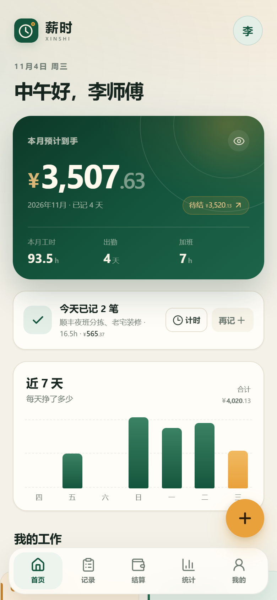
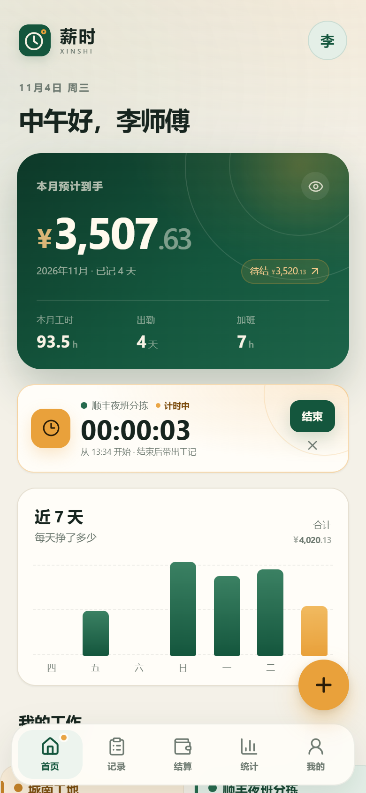
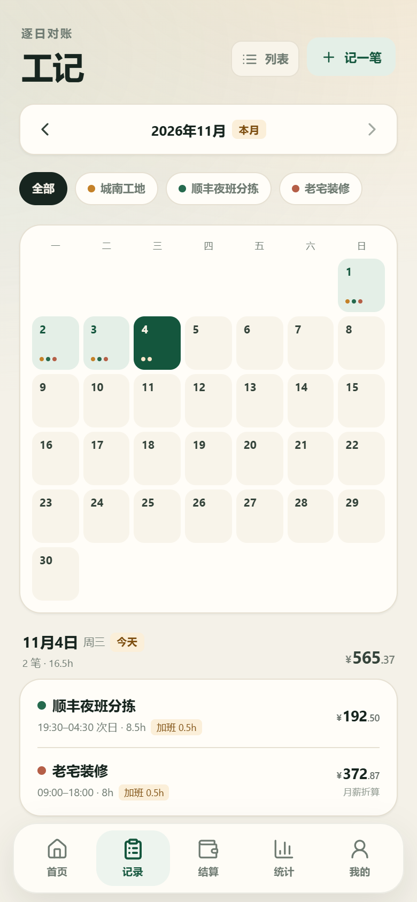
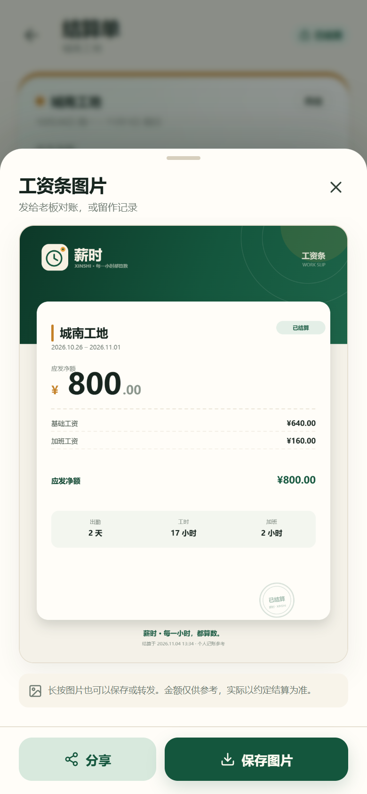
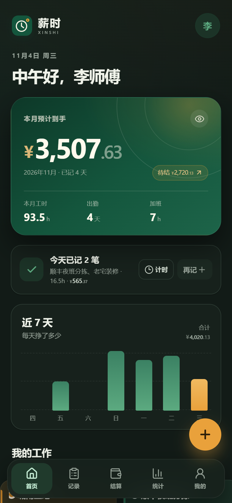
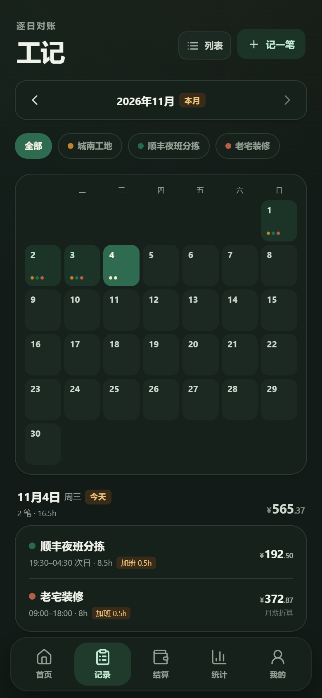
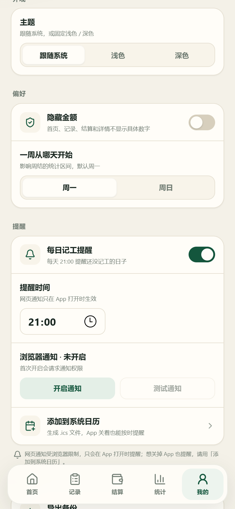

# 薪时 XINSHI · v0.2

> **每一小时，都算数。**
>
> 给小时工、日结工、周结工和月结工用的「工时 + 薪资」记录 App。
> 记工时 → 自动算钱 → 逐期结算 → 留底对账，不登录也能用。



v0.1 把账算清；**v0.2 把「记」变快**：上工打卡计时、日历视图、每日提醒、工资条图片、深色模式。

## v0.2 新增

| 能力 | 说明 |
| --- | --- |
| ⏱ 打卡计时 | 开始 / 结束、刷新后继续、结束自动带出上下班时间；底部导航显示计时圆点 |
| 📅 日历视图 | 月历上有活的日子标岗位色点，点日期看当天明细；列表 / 日历随时切换 |
| 🔔 每日提醒 | 设定时间提醒当天还没记工；浏览器通知 + 可导入系统日历的 `.ics` 文件 |
| 🧾 工资条图片 | 从已结算单生成 1080×1440 PNG，下载或系统分享，带完整金额明细与结算章 |
| 🌙 深色模式 | 跟随系统 / 浅色 / 深色，刷新不白闪，全页面与弹层适配 |

> 从 v0.1 升级：旧账本自动迁移，无需操作；旧备份也能直接导入。

## 全部功能

| 模块 | 已实现 |
| --- | --- |
| 首次引导 | 称呼 + 第一份工作，可一键载入示例数据 |
| 多工作 | 时薪 / 日薪 / 月薪，日结 / 周结 / 月结，独立单价与规则 |
| 记工 | 上下班时间、休息、直接填工时、加班、奖金、扣款、备注、实时试算 |
| 自动计薪 | 时薪超时自动拆加班；周末 2×、节假日可勾选 3× |
| 月薪规则 | 按计薪天数折算，结算按月封顶，避免多出勤把月薪算超 |
| 记录 | 按月查看、按工作筛选、列表 / 日历、详情公式、编辑、删除 |
| 结算 | 最早未结周期逐期结清，工记快照 + 锁定，可撤销重结 |
| 借支 | 记录预支，结算时自动抵扣；支持删除未结借支 |
| 额外奖扣 | 结算时单独加减，不改动原始工记 |
| 统计 | 周 / 月收入、工时、出勤、平均时薪、加班占比、每日图表、工作分布 |
| 工资条 | 复制文字结算单 / 生成 PNG 图片 / 系统分享 |
| 数据 | JSON 导出 / 导入、清空、隐藏金额、本地持久化 |
| 外观 | 浅色 / 深色 / 跟随系统，主题持久化 |
| PWA | Manifest、图标、Service Worker，安装后离线可用 |

## 计薪规则（摘要）

- **时薪**：基础 =（总工时 − 加班工时）× 时薪；加班 = 加班工时 × 时薪 × 倍率。
- **日薪**：每条记录 = 出勤 1 天 × 日薪；加班 = 加班工时 ×（日薪 ÷ 标准工时）× 倍率。
- **月薪**：日折算 = 月薪 ÷ 月计薪天数；结算基础 = min(月薪 ÷ 计薪天数 × 当月出勤天数, 月薪)；加班按折算时薪计。
- 倍率优先级：法定节假日（手动）> 周六日（自动）> 平日；关闭加班后不产生加班费。
- 每条工记冻结当时的计薪规则，之后调价**不会**改变历史金额。
- 结算 = 未结工记 + 额外奖金 − 额外扣款 − 未抵扣借支；生成快照后锁定。
- 已结算周期**不能补记或修改**，需先撤销结算，避免重复发薪。

完整规则见 [产品规划 v0.1](docs/PLAN.md)；v0.2 设计与数据迁移见 [PLAN-v0.2](docs/PLAN-v0.2.md)。

## 界面

| 打卡计时 | 日历视图 | 工资条图片 |
| --- | --- | --- |
|  |  |  |

| 深色首页 | 深色日历 | 提醒设置 |
| --- | --- | --- |
|  |  |  |

更多：[引导](shots/v0.2/01-onboarding.png)、[记一笔](shots/v0.2/05-entry-editor.png)、[记录](shots/v0.2/06-records.png)、[统计](shots/v0.2/08-stats.png)、[结算](shots/v0.2/09-settlements.png)、[结算单](shots/v0.2/10-settlement-record.png)、[我的](shots/v0.2/12-profile.png)、[深色工记](shots/v0.2/16-records-dark.png)。

## 技术栈

- Vite 6 + React 19 + TypeScript（strict）
- 原生 CSS design tokens，无 UI 框架 / 图表库 / 图片库
- Canvas 2D 生成工资条，无服务端渲染
- `localStorage` 整包状态，v1 → v2 自动迁移
- Vitest 覆盖计薪、周期、结算、迁移、计时、提醒
- 手写 Service Worker + PWA Manifest
- 深色主题通过 CSS tokens + `data-theme` + 预置脚本实现

```
src/
  components/   基础 UI 与业务组件（Sheet、Money、BarChart、MonthCalendar、Payslip…）
  pages/        首页、记录、记一笔、结算、统计、我的、工作管理、引导
  hooks/        主题、提醒
  lib/          日期、金额、计薪、结算、存储、计时、提醒、工资条绘制
  store.tsx     全局状态、持久化、业务动作
  styles.css    设计系统、页面样式、深色主题
docs/           v0.1 规划 + v0.2 升级说明
scripts/        图标、截图、浏览器验收脚本
```

## 运行

```bash
pnpm install
pnpm dev       # 开发：http://127.0.0.1:5173
pnpm build     # 生产构建
pnpm preview   # 预览：http://127.0.0.1:4173
pnpm test      # 33 个单元测试
pnpm test:e2e  # 需先 pnpm preview，使用本机 Edge
pnpm shots     # 重新生成 v0.2 截图（需 preview）
```

> 离线能力只在生产构建 + preview / 静态部署下注册 Service Worker；开发模式不注册，避免干扰 HMR。

## 数据版本

- 新存储键：`xinshi.state.v2`。
- 启动时优先读 v2；找不到则读 `xinshi.state.v1`，校验、补默认值、写入 v2，再删除旧键。
- 导出包 `version: 2`；导入兼容 v1 与 v2。
- v0.2 新增 `settings.theme`、`settings.reminder`、`activeTimer`。
- 参考实现：`src/lib/storage.ts`。

## 验收记录

- 单元测试：**33 / 33 通过**。
  - 计薪 / 结算 / 周期 22
  - 存储迁移 5
  - 计时 4
  - 提醒 2
- 浏览器自动化（Edge + Playwright Core）：**24 个场景通过**。
  - v0.1 回归：记工、编辑、删除、结算锁定、撤销、借支、调价快照、导入导出、清空、隐藏金额、离线。
  - v0.2：计时跨刷新、结束带出、日历切换、工资条生成 / 下载、提醒设置 / ICS、深色切换与持久化。
- 真实 v0.1 localStorage 数据迁移通过，旧工作 / 工记 / 结算正常加载。
- 320 / 360 / 390 / 430 / 768 / 1280px 均无横向溢出。
- 控制台错误 0；生产构建通过，产物含 Manifest、图标与 Service Worker。

## 已知限制

- **提醒**：PWA 无法可靠地在关闭后后台定时通知；浏览器通知需 App 打开。用「添加到系统日历」可导入每日提醒。
- **计时**：同一时间只能一个，不支持暂停；超过 24 小时需人工核对；结束计时后关闭工记不会自动保存。
- **工资条**：固定 PNG 与浅色模板，主要金额项；不支持企业抬头 / 自定义模板。
- **本地优先**：无账号与云同步，换设备需导出 / 导入；清浏览器数据会丢账本。
- **月薪边界**：月中调薪按当月最新单价快照封顶；月中入职 / 离职建议用结算「额外奖扣」调整。
- **计薪结果仅供参考**，不构成劳动、税务或法律意见。

## 下一步

- v0.3：可选账号与端到端加密云同步、PDF 对账单、计件工资、自动备份提醒、更可靠的后台通知。
- v1.0：微信小程序 / 原生壳、拍照水印考勤、工头多人记工、Excel 导出。

## 说明

薪时是个人记账工具，不提供招聘、支付、社保代缴或合规判断。数据只存在本机，请定期备份。
