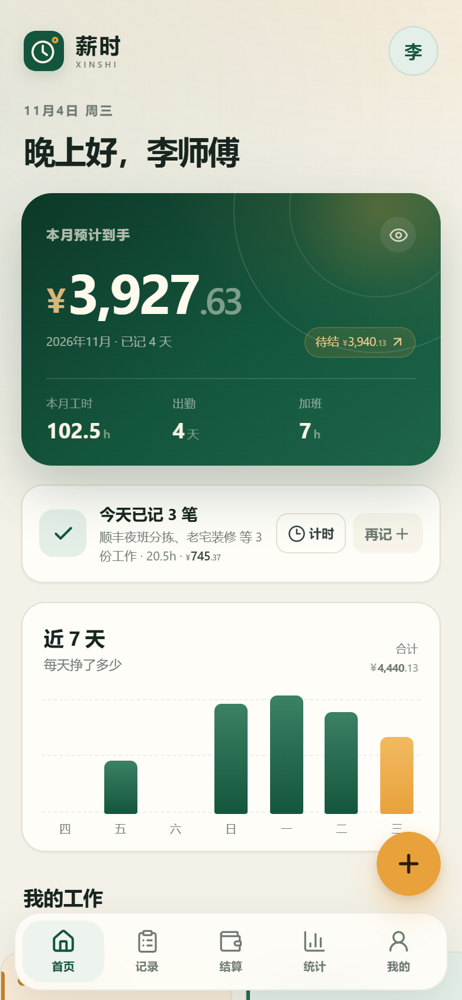
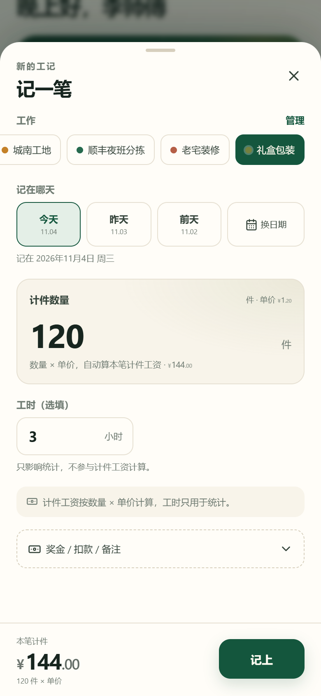
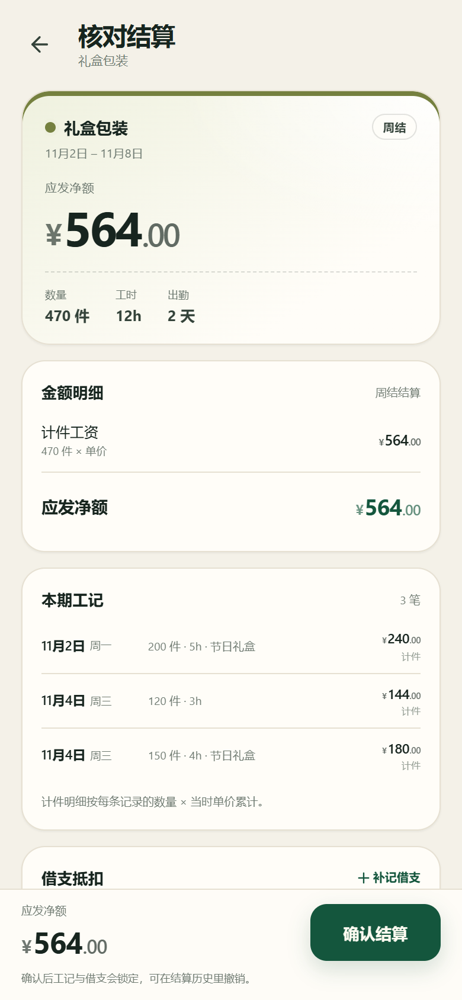
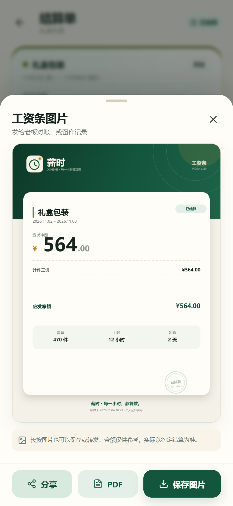
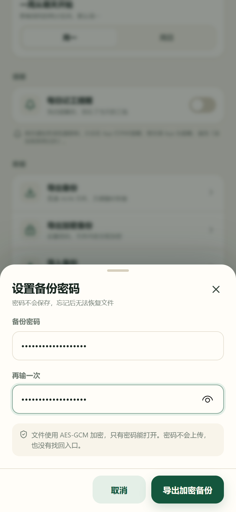
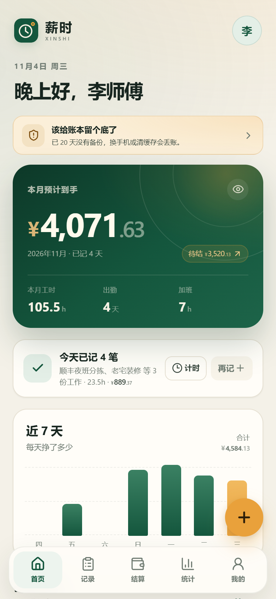
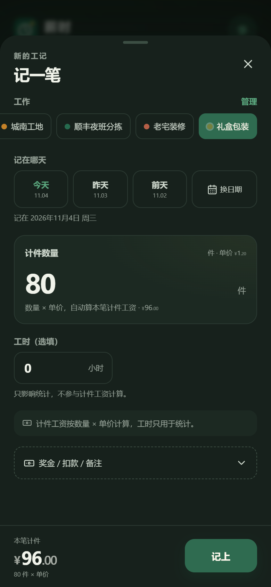

# 薪时 XINSHI · v0.3

> **每一小时，都算数。**
>
> 给小时工、日结工、周结工和月结工用的「工时 + 薪资」记录 App。
> 记工时 → 自动算钱 → 逐期结算 → 留底对账，不登录也能用。



v0.2 把「记」变快；**v0.3 把账算得更全、存得更稳**：计件工资、PDF 对账单、AES-GCM 加密备份、备份到期提醒。

> 已封装 Android APK（Capacitor 原生壳），见 [Android APK](#android-apk)。

## v0.3 新增

| 能力 | 说明 |
| --- | --- |
| 🧮 计件工资 | 每件单价 + 单位（件 / 米 / 平方 / 单），数量 × 单价自动算；结算快照保留数量与单位 |
| 📄 PDF 对账单 | 已结算单生成单页 PDF，工资条图片 + 完整明细，方便打印 / 归档 |
| 🔐 加密备份 | AES-256-GCM + PBKDF2-SHA256（25 万次），密码不保存；文件里没有工作名和金额明文 |
| 🛡 备份提醒 | 有工记但 7 天没备份 / 距上次备份 14 天，首页提醒留底；「我的」显示上次备份日期 |

> 从 v0.2 升级：本地账本自动迁移到 v3；v1 / v2 备份继续可导入。

## 全部功能

| 模块 | 已实现 |
| --- | --- |
| 首次引导 | 称呼 + 第一份工作，可一键载入示例数据 |
| 多工作 | 时薪 / 日薪 / 月薪 / 计件，日结 / 周结 / 月结，独立单价与规则 |
| 记工 | 上下班时间、休息、直接填工时、计件数量、加班、奖金、扣款、备注、实时试算 |
| 自动计薪 | 时薪超时自动拆加班；周末 2×、节假日可勾选 3×；计件按数量 × 单价 |
| 月薪规则 | 按计薪天数折算，结算按月封顶，避免多出勤把月薪算超 |
| 记录 | 按月查看、按工作筛选、列表 / 日历、详情公式、编辑、删除 |
| 结算 | 最早未结周期逐期结清，工记快照 + 锁定，可撤销重结 |
| 借支 | 记录预支，结算时自动抵扣；支持删除未结借支 |
| 额外奖扣 | 结算时单独加减，不改动原始工记 |
| 统计 | 周 / 月收入、工时、出勤、平均时薪、加班占比、每日图表、工作分布 |
| 工资条 | 复制文字结算单 / PNG 图片 / PDF / 系统分享 |
| 数据 | JSON 导出 / 导入、加密导出 / 导入、清空、隐藏金额、本地持久化 |
| 备份 | 上次备份日期、到期提醒、密码加密 |
| 外观 | 浅色 / 深色 / 跟随系统，主题持久化 |
| PWA | Manifest、图标、Service Worker，安装后离线可用 |

## 计薪规则（摘要）

- **时薪**：基础 =（总工时 − 加班工时）× 时薪；加班 = 加班工时 × 时薪 × 倍率。
- **日薪**：每条记录 = 出勤 1 天 × 日薪；加班 = 加班工时 ×（日薪 ÷ 标准工时）× 倍率。
- **月薪**：日折算 = 月薪 ÷ 月计薪天数；结算基础 = min(月薪 ÷ 计薪天数 × 当月出勤天数, 月薪)；加班按折算时薪计。
- **计件**：金额 = 数量 × 记录时单价 + 奖金 − 扣款；不计加班，工时只做统计。
- 倍率优先级：法定节假日（手动）> 周六日（自动）> 平日；关闭加班后不产生加班费。
- 每条工记冻结当时的计薪规则，之后调价**不会**改变历史金额。
- 结算 = 未结工记 + 额外奖金 − 额外扣款 − 未抵扣借支；生成快照后锁定。
- 已结算周期**不能补记或修改**，需先撤销结算，避免重复发薪。

完整规则见 [产品规划 v0.1](docs/PLAN.md)；v0.3 设计与迁移见 [PLAN-v0.3](docs/PLAN-v0.3.md)。

## 界面

| 计件记工 | 计件结算 | PDF 工资条 |
| --- | --- | --- |
|  |  |  |

| 加密备份 | 备份提醒 | 深色计件 |
| --- | --- | --- |
|  |  |  |

更多：[引导](shots/v0.3/01-onboarding.png)、[首页](shots/v0.3/02-home.png)、[工作列表](shots/v0.3/03-home-jobs.png)、[计件详情](shots/v0.3/05-piece-detail.png)、[计件结算单](shots/v0.3/07-piece-record.png)、[数据设置](shots/v0.3/10-profile-data.png)、[计件工作设置](shots/v0.3/11-job-editor-piece.png)。

## 技术栈

- Vite 6 + React 19 + TypeScript（strict）
- 原生 CSS design tokens，无 UI 框架 / 图表库
- Canvas 2D 生成工资条，jsPDF 动态加载生成 PDF
- Web Crypto：PBKDF2-SHA256 + AES-256-GCM 加密备份
- `localStorage` 整包状态，v1 / v2 → v3 自动迁移
- Vitest 覆盖计薪、周期、结算、迁移、计时、提醒、加密
- 手写 Service Worker + PWA Manifest
- Capacitor 6 Android 壳（资源打进 APK，原生保存插件）
- 深色主题通过 CSS tokens + `data-theme` + 预置脚本实现

```
src/
  components/   基础 UI 与业务组件（Sheet、Money、BarChart、MonthCalendar、Payslip…）
  pages/        首页、记录、记一笔、结算、统计、我的、工作管理、引导
  hooks/        主题、提醒
  lib/          日期、金额、计薪、结算、存储、计时、提醒、工资条、加密备份
  store.tsx     全局状态、持久化、业务动作
  styles.css    设计系统、页面样式、深色主题
docs/           v0.1 / v0.2 / v0.3 规划 + 云同步设计
scripts/        图标、截图、浏览器验收脚本
```

## 运行

```bash
pnpm install
pnpm dev       # 开发：http://127.0.0.1:5173
pnpm build     # 生产构建
pnpm preview   # 预览：http://127.0.0.1:4173
pnpm test      # 41 个单元测试
pnpm test:e2e  # 需先 pnpm preview，使用本机 Edge
pnpm shots     # 重新生成 v0.3 截图（需 preview）
pnpm android:sync  # 构建 Web + 同步到 Android 工程
```

> 离线能力只在生产构建 + preview / 静态部署下注册 Service Worker；开发模式不注册，避免干扰 HMR。原生 APK 内不注册 Service Worker。<br>
> Android 构建、签名与测试说明见 [android/README.md](android/README.md)。

## Android APK

已用 Capacitor 封装成原生 Android 壳，Web 资源内嵌，**不依赖电脑上的预览服务**。


- 测试包：`release/xinshi-v0.3.0.apk`（本机签名，未提交 Git）。
- 包名：`com.xinshi.app`；版本：`0.3.0`；安装支持 Android 5.0+，文件导出建议 Android 10+。
- 导出备份 / PDF / 工资条图片会写入公共目录 **Download/Xinshi/**，不依赖分享面板。
- 返回键优先关闭弹层 / 子页面；首页再按收起到后台。
- 已在雷电模拟器 LDPlayer 14（Android 14 / x86_64）验证启动、示例数据、计件、加密备份保存/导入、PDF/PNG 保存和返回键。
- 构建：`pnpm build && pnpm exec cap sync android`，再用 Android Studio 或 Gradle 打开 `android/`。详见 [android/README.md](android/README.md)。

更多实机截图：[原生导出](shots/apk/04-export.png)、[启动图标](shots/apk/03-launcher.png)。

## 数据版本

- 新存储键：`xinshi.state.v3`。
- 启动时优先读 v3；找不到则读 v2 / v1，校验、补默认值、写入 v3，再删除旧键。
- 导出包 `version: 3`；导入兼容 v1 / v2 / v3。
- v0.3 新增 `PayRule.unitLabel`、`Entry.quantity`、结算上的 `payType / quantity / unitLabel`。
- 旧结算没有计件字段时保持未知，不按当前工作规则猜测。
- 参考实现：`src/lib/storage.ts`。

## 验收记录

- 单元测试：**41 / 41 通过**。
  - 计薪 / 结算 / 周期 25（含计件 3）
  - 存储迁移 6
  - 加密备份 4
  - 计时 4
  - 提醒 2
- 浏览器自动化：**30 个场景通过**。
  - v0.1 回归 10
  - v0.2 回归 7
  - v0.3 新增 6：计件引导、计件记工、计件结算 + PDF、加密导出、错密码拒绝 / 正确恢复、备份到期提醒
- PDF 文件头 `%PDF-`，约 180 KB，可正常下载。
- 加密备份不含工作名 / 称呼明文；错密码与篡改均拒绝。
- Android 测试包在雷电 LDPlayer 14（Android 14 / x86_64）通过：启动、示例数据、计件、加密备份保存 / 导入、PDF / PNG 保存到 `Download/Xinshi`、返回键关闭弹层。
- 320 / 360 / 390 / 430 / 768 / 1280px 均无横向溢出。
- 控制台错误 0；生产构建通过，产物含 Manifest、图标与 Service Worker。

## 已知限制

- **计件**：一份工作只维护一个单位；不支持阶梯价、工序价、团队计件；计件不计加班。
- **PDF**：单页图片型 PDF，文字不可选中；不支持企业抬头 / 自定义模板。
- **加密备份**：密码不会保存，忘记后无法恢复；没有密钥托管。
- **备份提醒**：只记录本机导出时间，不跨设备。
- **提醒**：PWA 无法可靠后台定时通知；浏览器通知需 App 打开，系统日历 `.ics` 是替代方案。
- **计时**：同一时间只能一个，不支持暂停；超过 24 小时需人工核对。
- **本地优先**：无账号与云同步，换设备需导出 / 导入；清浏览器数据会丢账本。
- **Android**：测试包为本机签名，未上架应用商店；debug / release 签名不同，切换安装需先卸载。APK 内导出直接写 `Download/Xinshi`，不使用系统分享面板；导入仍走系统文件选择器。
- **云同步未实现**：需要可托管的账号后端；方案见 [CLOUD-SYNC](docs/CLOUD-SYNC.md)，列入 v0.4。
- **计薪结果仅供参考**，不构成劳动、税务或法律意见。

## 下一步

- v0.4：可选账号与端到端加密云同步（自托管 / 托管）、可靠后台提醒。
- 之后：PDF 文字版 / 自定义抬头、阶梯计件、微信小程序、拍照水印考勤、工头多人记工、应用商店上架。

## 说明

薪时是个人记账工具，不提供招聘、支付、社保代缴或合规判断。数据只存在本机，请定期备份。
